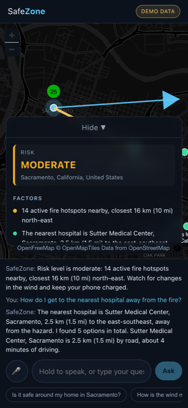

# SafeZone

**A voice safety assistant with a map.** Ask whether a place is safe, and SafeZone pulls live hazard
data from several open sources, reasons about the risk, answers in one or two spoken sentences, and
draws everything on a map.

SafeZone is built as a **self-hosted MCP server** (spec revision `2025-11-25`, Streamable HTTP), so
the same tools serve Alexa+ and our own web simulator. The simulator adds what a voice-only
assistant cannot show: the map.

> ⚠️ SafeZone is a demonstration project. It does not replace official emergency services.
> In an emergency, call 911 and follow the instructions of local authorities.


_"Is it safe around my home in Sacramento?" — the answer is spoken, and drawn._

## Status

Milestones **M1**–**M8** are complete as far as they can be from inside the repository: nine MCP
tools including `assess_risk` and `get_route`, an agent service that runs the tool loop, a simulator
that listens, answers out loud and draws the result, recorded fixtures so the whole thing runs with
no API keys, the AWS infrastructure as CDK code, and the submission material.

Three things are left, and none of them can be done from here: **deploying** (needs AWS
credentials), **recording the video** (`docs/VIDEO-SCRIPT.md` has the shot list and narration), and
**submitting on Devpost** (`docs/DEVPOST.md` is written, ready to paste). `docs/SUBMISSION.md`
tracks all of it.

**It is deployed and live: https://d227d864bivil2.cloudfront.net** — running on real data in
`ap-southeast-2`, speaking with Amazon Polly. The MCP server is at
`https://ayqlrjlocnuxkk44xu3xs32pqe0lcqqd.lambda-url.ap-southeast-2.on.aws/mcp`, which is the address to
register with Alexa+ or to open in MCP Inspector. See `docs/DEPLOY.md` for the runbook.

**Amazon Bedrock is not switched on yet.** The AWS account is still being verified, so the agent
runs the scripted fallback from SPEC 7.4 rather than a Bedrock tool loop. The loop itself is
written and unit-tested against a fake Converse client; turning it on is one redeploy.

**Alexa+ is not connected.** The MCP server is what the Alexa+ track asks for and it is ready to
register, but the developer preview is not available to us, so the simulator is the demo. The rules
allow that.

| Tool                 | Source                                     | State   |
| -------------------- | ------------------------------------------ | ------- |
| `geocode`            | Amazon Location, Open-Meteo as fallback    | ✅ done |
| `get_fire_hotspots`  | NASA FIRMS (VIIRS)                         | ✅ done |
| `get_weather_alerts` | NOAA / National Weather Service            | ✅ done |
| `get_earthquakes`    | USGS                                       | ✅ done |
| `get_air_quality`    | Open-Meteo Air Quality (US AQI, EPA bands) | ✅ done |
| `get_wind`           | Open-Meteo Forecast                        | ✅ done |
| `find_safe_places`   | OpenStreetMap via Overpass                 | ✅ done |
| `assess_risk`        | all of the above                           | ✅ done |
| `get_route`          | Amazon Location Routes, OSRM as fallback   | ✅ done |

Only NASA FIRMS needs an API key. Everything else works with no credentials at all, and
`DEMO_MODE=true` serves recorded responses for every tool.

## Quick start (no API keys)

```bash
npm install
npm run build
npm run demo
```

That starts the MCP server with recorded data, the agent in scripted mode, and the simulator. Open
http://localhost:5173 and try one of the three suggested questions, by voice or by typing.

Other useful commands:

```bash
npm run smoke         # initialize + tools/list + tools/call against a running server
npm run inspector     # MCP Inspector; connect to http://localhost:8787/mcp (Streamable HTTP)
npm run dev:server    # the MCP server on :8787
npm run dev:agent     # the agent on :8788
npm run dev:web       # the simulator on :5173
```

## How the risk level is decided

`assess_risk` is the tool that matters. It calls the others in parallel and applies an explicit rule
set (SPEC 6) rather than averaging anything, so every level can be explained:

- a hotspot within 10 km, or within 30 km and **upwind** in a wind of 15 km/h or more → **high**
- an official alert carries its own severity through; AQI above 100 raises the level in EPA bands;
  a magnitude 5 quake within 100 km in the last day is moderate, magnitude 6 is high
- two high factors from **different** sources compound to **extreme**

"Upwind" is the part worth reading twice: weather APIs report the direction the wind comes **from**,
so a fire sitting in that direction is the one whose smoke reaches you. Getting it backwards would
invert the most important judgement the product makes, so it is tested both at the rule level and
through the whole tool.

A source that fails is left out and named in the answer rather than failing the assessment.

## How a question is answered

```
   ┌───────────────────────┐          ┌────────────────────┐
   │  web simulator        │          │  Alexa+ (optional) │
   │  voice · chat · map   │          │  its own agent     │
   └───────────┬───────────┘          └─────────┬──────────┘
               │ POST /api/chat                 │ MCP, Streamable HTTP
               ▼                                │
   ┌───────────────────────┐                    │
   │  agent service        │                    │
   │  Bedrock tool loop    │── MCP client ──────┤
   │  Polly (speech)       │                    │
   └───────────────────────┘                    ▼
                              ┌─────────────────────────────────┐
                              │  MCP server "safezone"          │
                              │  geocode · fires · alerts ·     │
                              │  quakes · air · wind · places · │
                              │  route · assess_risk            │
                              └────────────────┬────────────────┘
                                               ▼
        NASA FIRMS · NOAA/NWS · USGS · Open-Meteo · OpenStreetMap · Amazon Location
```

Every tool returns one `SafetyToolResult`: a short spoken summary, the map layers to draw, the
numbers behind it, and where they came from. Alexa+ reads the summary; the simulator also draws the
layers. The browser holds no hazard logic of its own.

The agent picks the tools — with Amazon Bedrock when `BEDROCK_ENABLED=true`, otherwise with the
scripted fallback from SPEC 7.4, so the whole flow runs without an AWS account.

## Voice

Input uses the browser's Web Speech API (Chrome and Safari; elsewhere the text box is the way in).
Hold the microphone button and speak. Output prefers Amazon Polly through `POST /api/tts`; when
Polly is not configured the agent answers 503 and the simulator falls back to the browser's own
voice, so the demo always talks.

## The map

A full-screen dark map with a risk panel (`web/`, Vite + React + MapLibre). Fire hotspots are sized
by radiative power, alert polygons coloured by severity, the wind arrow flows in the direction the
smoke is going, the recommended hospital is highlighted, and the route to it is drawn as a road
line. Your location pulses like a device that is listening.

Clicking a feature opens a popup with its details and its source, one at a time. The legend lists
only the layers actually on the map, and each entry switches its layer off — with five hazards drawn
at once, hiding the fires to see the alert polygon underneath is the difference between a map and a
mess. Every animation stops for `prefers-reduced-motion`.

### Following up


The conversation carries. The fire clusters found a moment ago are passed back in as zones to
avoid, so the hospital it picks is not the one in the direction of the fire.



## Running with live data

```bash
cp .env.example .env
DEMO_MODE=false npm run demo
```

Values in `.env` are picked up automatically — every entry point loads it, and Vite reads the same
file for the simulator.

**Eight of the nine tools work immediately**, with no keys and no account: NWS, USGS, Open-Meteo,
Overpass and OSRM are all open. Only fire hotspots need a key. These optional settings add the
rest:

- `FIRMS_MAP_KEY` — free from https://firms.modaps.eosdis.nasa.gov/api/map_key/, enables
  `get_fire_hotspots`. Without it that one tool answers with a clear error and the others are
  unaffected.
- `AMAZON_LOCATION_API_KEY` — makes `geocode` use Amazon Location Service instead of Open-Meteo.
- `NWS_USER_AGENT` — the National Weather Service asks for a contact address in the User-Agent.
- `BEDROCK_ENABLED=true` — the agent picks tools with a Bedrock model instead of the scripted
  fallback. The model in `BEDROCK_MODEL_ID` must be enabled in your region under Bedrock "Model
  access", and the service needs `bedrock:InvokeModel`.
- `POLLY_ENABLED=true` — replies are spoken by Amazon Polly instead of the browser voice.

Weather alerts cover US locations only; elsewhere the tool says so instead of failing.

## Demo fixtures

`server/fixtures` holds recorded API responses for four scenarios: Sacramento, Los Angeles, Chicago
(nothing active) and Hilo, Hawaii (a real hurricane watch). Refresh them with:

```bash
npm run record-fixtures
```

Everything except the fire CSVs is recorded from the live keyless APIs; the fire CSVs are
placeholders until the script runs with a `FIRMS_MAP_KEY`.

## Deploying to AWS

The whole stack is AWS CDK in `infra/`: CloudFront and S3 for the simulator, a Lambda Function URL
each for the agent and the MCP server, log groups, and an optional budget alert.

```bash
npm install
npm run deploy
```

`docs/DEPLOY.md` has the runbook: bootstrapping, the NASA FIRMS key in Secrets Manager, Bedrock
model access, every context flag, and how to tear it all down.

## Repository layout

```
shared/   the SafetyToolResult contract and geo helpers, used by every package
server/   the MCP server: tools, source clients, demo fixtures
agent/    the agent service: Bedrock tool loop, scripted fallback, Polly
web/      the simulator: map, risk panel, voice
infra/    the AWS CDK stack
scripts/  demo runner, smoke test, fixture recorder
docs/     architecture, deployment runbook, submission material
```

| Document                        | What it is                                         |
| ------------------------------- | -------------------------------------------------- |
| `docs/ARCHITECTURE.md`          | why the pieces are shaped the way they are         |
| `docs/DEPLOY.md`                | the AWS runbook, including tear-down               |
| `docs/SUBMISSION.md`            | the submission checklist and what is still blocked |
| `docs/DEVPOST.md`               | the Devpost text, ready to paste                   |
| `docs/VIDEO-SCRIPT.md`          | shot list, narration and timings for the video     |
| `docs/AMAZON-TOOLS-FEEDBACK.md` | our review of the Amazon tools                     |
| `docs/FRICTION-LOG.md`          | every problem we hit with Amazon tooling           |

## Development

```bash
npm test         # vitest: parsing, risk logic, contracts, the agent loop, the browser client
npm run lint     # eslint + prettier
npm run typecheck
```

## License

MIT — see `LICENSE`.
